# Awesome-Game-Networking-Player-Movement-Engines


  





  
  
  
  
  



# 🌐 Top Game Networking & Player Movement Engines

**Curated List of SaaS/Commercial Platforms & Open-Source GitHub Projects**  
*Focused on Client-Side Prediction & Lag Compensation, Authoritative Server Netcode, Rollback Fighting-Game Engines, Reliable UDP Transport & Dedicated Server Orchestration*  
**Last updated: November 2026**

This repository tracks notable **SaaS/Commercial platforms** and **open-source projects** for **Game Networking & Player Movement Engines**. These tools power server-authoritative player movement synchronization, client-side prediction and reconciliation (`anymove`, `Fish-Networking`, `Mirror`, `Unity Netcode`), deterministic rollback netcode (`GGPO`, `GGRS`), low-latency reliable UDP/WebTransport protocols (`ENet`, `GameNetworkingSockets`, `LiteNetLib`), and Kubernetes dedicated game-server orchestration (`Agones`, `Nakama`, `Colyseus`) for multiplayer gameplay programmers and network engineers.

**Examples** include PlayFab Multiplayer (Microsoft Azure), GameSparks (Amazon Web Services), Unreal Engine Multiplayer (Epic Games), Unity Netcode & Gaming Services, Photon Engine (Exit Games), SpatialOS Cloud (Improbable), Heroic Labs Cloud (Nakama), Hathora, Colyseus Cloud, and Mirror Networking (Commercial Add-Ons / List-Server Ecosystem) (the category leaders).

**🚀 Open-source emphasis**: This section is heavily expanded with every major active project for player movement & prediction engines (`patch-gg/anymove`, `Mirror`, `Netcode for GameObjects`, `Godot High-Level Multiplayer`, `Lightyear`), reliable UDP & transport layers (`Valve GameNetworkingSockets`, `ENet`, `LiteNetLib`, `Netcode.io`), rollback netcode (`GGPO`, `GGRS`), authoritative game backends (`Nakama`, `Colyseus`, `SpacetimeDB`), and Kubernetes server orchestrators (`Agones`, `Open Match`) — ideal for multiplayer teams eliminating CCU lock-in.

🤝 Contributions welcome! Open a PR to add/update entries. Keep descriptions factual and link to official sites.

## 📑 Table of Contents
- [📊 Sector Overview & Market Dynamics](#-sector-overview--market-dynamics)
- [☁️ SaaS/Hosted & Commercial Platforms](#️-saashosted--commercial-platforms)
- [💻 Open-Source GitHub Projects](#-open-source-github-projects)
- [🛠️ How to Contribute](#️-how-to-contribute)
- [⚠️ Disclaimer](#️-disclaimer)
- [💖 Support & Thank You](#-support--thank-you)

## 📊 Sector Overview & Market Dynamics

The global Multiplayer Game Backend, Dedicated Server Hosting & Networking Middleware market is valued at approximately **$6.8B–$8.6B+ in 2026**, expanding at a ~15%–20% CAGR propelled by cross-platform co-op hits, deterministic physics synchronization, and edge-orchestrated dedicated servers. The commercial cloud hosting and relay layer exhibits **strong winner-take-most consolidation** around hyperscalers (Microsoft PlayFab, AWS GameLift) and Photon Engine, whereas the **player-movement prediction, reliable UDP transport, and authoritative server framework layers are overwhelmingly open-source led** (`Mirror`, `ENet`, `GameNetworkingSockets`, `Nakama`, `Colyseus`, `Agones`).

## ☁️ SaaS/Hosted & Commercial Platforms

*Sorted descending by company valuation / annual revenue scale.*

| Platform | Description | Company Scale (Valuation / Revenue) | Starting Paid Tier | Free Tier / Trial Limit |
| :--- | :--- | :--- | :--- | :--- |
| **[Microsoft PlayFab Multiplayer](https://playfab.com)** | Full-stack live-ops backend, Thunderhead dedicated server hosting, matchmaking, and Azure PlayFab Party voice/network relay service. | **Part of Microsoft Azure** (~$85B+ Azure cloud revenue; ~$3T+ parent market cap) | **$99 / month** for Standard plan + pay-as-you-go dedicated VM compute & relay hours | **Forever Free Development Tier** (Up to **100,000 players**, 750 free dedicated server compute hours, and free Party relay testing) |
| **[Amazon GameSparks / AWS GameLift](https://amazon.com)** | AWS managed dedicated game server fleet orchestration, FlexMatch matchmaking, and real-time multiplayer backend services (succeeded legacy GameSparks). | **Part of Amazon / AWS** (~$115B+ AWS annual revenue; ~$2T+ parent market cap) | **Pay-as-you-go EC2 Compute** (e.g., `c6i.large` from **~$0.085/hr** + FlexMatch **$1.00 per 1,000 matchmaking hours**) | **12-Month AWS Free Tier** (**125 hours/month** of `c4.large` / `c5.large` GameLift compute + 50 GB EBS storage free for 12 months) |
| **[Unreal Engine Multiplayer (Epic Games)](https://unrealengine.com)** | Built-in C++ CharacterMovementComponent client-side prediction, Replication Graph, Iris replication system, and Epic Online Services (EOS) P2P relay. | **~$22.5B+ Valuation** (~$6B+ annual revenue; backed by Tencent/Sony/Disney) | **5% gross royalty** only after a commercial game exceeds **$1,000,000** lifetime gross revenue ($0 for EOS P2P relay) | **100% Free Forever** (Full source access, CharacterMovement prediction, Iris netcode, and unlimited Epic Online Services relay free) |
| **[Unity Netcode & Gaming Services (UGS)](https://unity.com)** | Official Unity Netcode for GameObjects / Entities paired with Unity Relay, Lobby, Matchmaker, and Multiplay dedicated server hosting. | **~$1.8B+ Annual Revenue** (~$8B–$10B public market cap) | **Pay-as-you-go UGS Usage** (Relay from **~$0.015/GB**, Multiplay compute per core-hr; Pro engine $2,040/seat/yr >$200k rev) | **Forever Free UGS Starter Quota** (Up to **50 Monthly Active Users (MAU)** and **500 GB Relay bandwidth/month** free indefinitely) |
| **[Photon Engine (Exit Games)](https://photonengine.com)** | Industry-standard global multiplayer cloud offering Photon Fusion (tick-accurate prediction/rollback), Quantum (deterministic ECS), and PUN relays. | **~$50M–$100M Est. Scale** (Profitable German multiplayer middleware giant; >800k devs) | **$95 / month** for 500 Concurrent Users (CCU) on Photon Fusion / Quantum / Realtime | **Forever Free 20 CCU Plan** (Up to **20 Concurrent Users (CCU)** and 60 GB traffic/month free forever for Fusion, Quantum, and Voice) |
| **[SpatialOS Cloud (Improbable)](https://improbable.io)** | Distributed multi-server spatial simulation and massive-scale virtual world networking technology powering high-density multiplayer experiences. | **~$1.0B+ Peak Valuation** (~$100M+ group revenue across Improbable ventures) | **Enterprise Custom Contract** (Dedicated cloud cluster orchestration for large-scale persistent worlds) | **Partner / Enterprise Evaluation** (No public self-serve free tier; custom proof-of-concept cluster via enterprise inquiry) |
| **[Heroic Labs Cloud (Nakama)](https://heroiclabs.com)** | Managed global cloud hosting for the open-source Nakama real-time multiplayer server, authoritative match loops, leaderboards, and Satori live-ops. | **~$25M–$50M Est. Valuation** (~$10M+ est. ARR; profitable open-core gaming backend) | **$50 / month** for Starter managed cloud cluster (scales by CCU and dedicated node size) | **14-Day Cloud Trial / Forever Free Self-Hosted** (14-day managed cloud trial; self-hosted Nakama Apache-2.0 is **100% free forever**) |
| **[Hathora](https://hathora.dev)** | Edge-distributed serverless container orchestrator for low-latency dedicated game servers across 15+ global regions with instant spin-up. | **~$30M–$50M Est. Valuation** ($10M+ VC funding led by Upfront/Ludlow) | **Pay-as-you-go Compute** (Billed per active vCPU-hour starting around **~$0.04–$0.06/vCPU-hr** only when players are connected) | **Forever Free Developer Tier** (Includes **$10/month in free compute credits** indefinitely with zero idle cost when rooms are empty) |
| **[Colyseus Cloud](https://colyseus.io)** | Official managed auto-scaling cloud platform for the open-source Colyseus Node.js/TypeScript authoritative multiplayer framework. | **~$5M–$15M Est. Scale** (Independent open-core multiplayer framework studio) | **$25 / month** for Starter cloud server (1 vCPU, 1 GB RAM, automated SSL and scaling) | **14-Day Free Trial / Forever Free Self-Hosted** (14-day managed cloud trial; self-hosted Colyseus MIT framework is **100% free forever**) |
| **[Mirror Networking (Asset Store Pro Add-Ons & List Server)](https://mirror-networking.com)** | Flagship open-source Unity networking library complemented by optional commercial transport/interest-management add-ons and hosted List Server. | **Community & Indie Studio Ecosystem** (Maintained by vis2k & contributors) | **$0 / Free MIT Core** (Optional Asset Store pro add-ons ~$15–$50 one-time) | **100% Free Forever Core** (Full MIT-licensed Mirror networking framework, transports, and prediction examples free forever) |

## 💻 Open-Source GitHub Projects

| Project | License / Hosting Cost | Free Tier / Self-Hosted Limit | Description |
